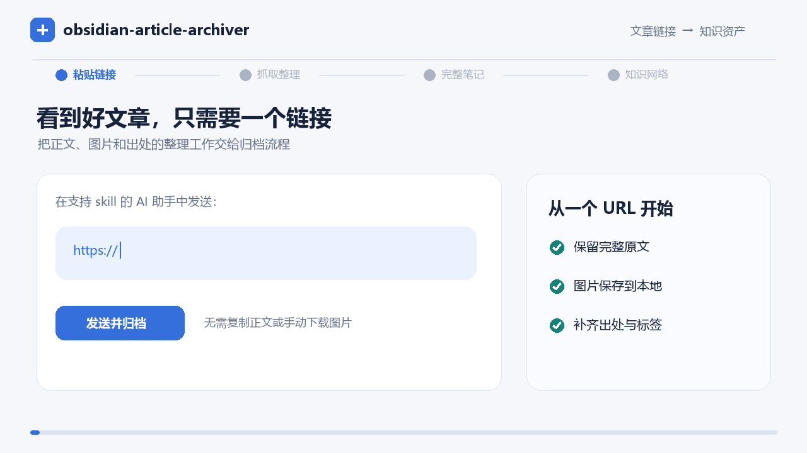
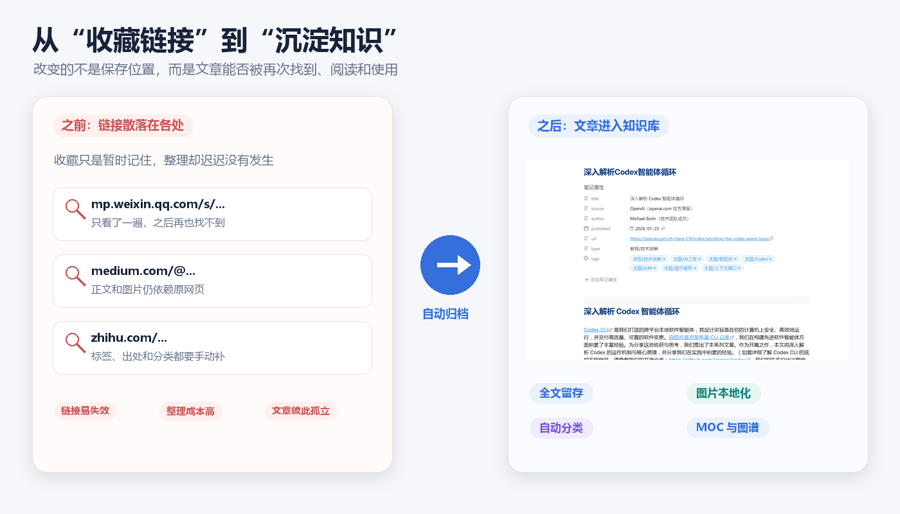
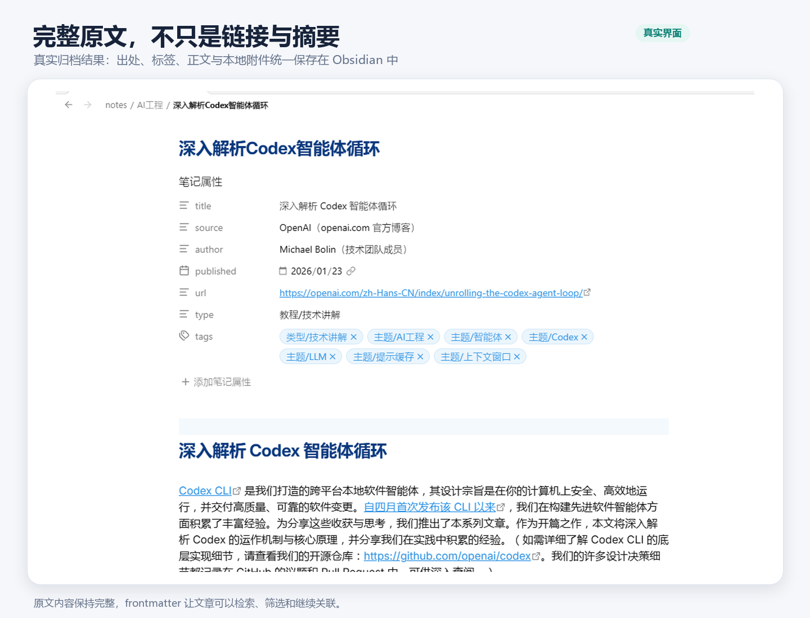
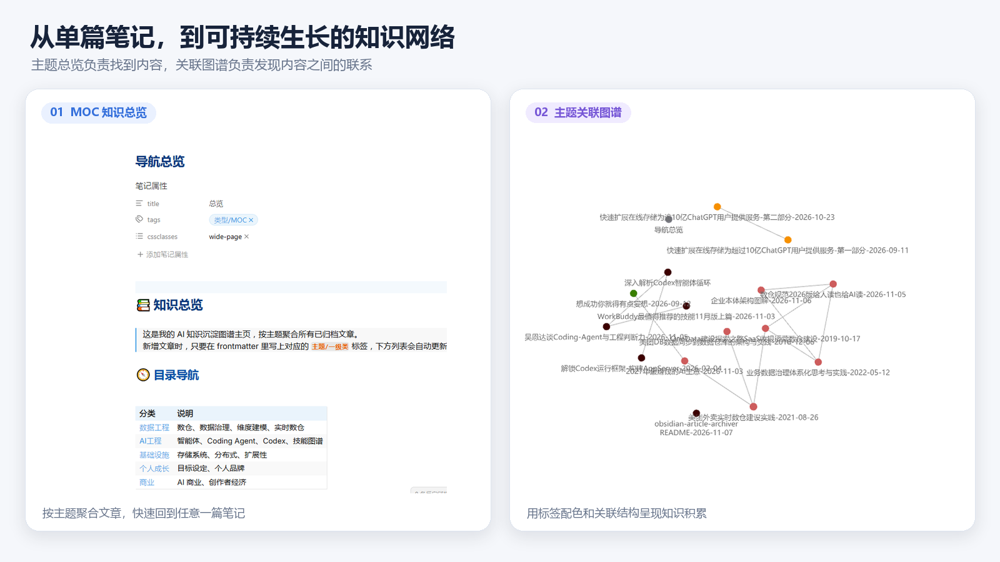

# obsidian-article-archiver

[](https://github.com/atcXiGua/obsidian-article-archiver/stargazers)
[](LICENSE)
[](#运行前提)
[](#示例效果)

> **把网页文章变成可检索、可关联、可长期保存的 Obsidian 笔记。**

贴上一个文章链接，让支持 skill 的 AI 助手帮你完成正文抓取、图片本地化、元数据整理、主题分类与归档。**不是只收藏一个 URL，也不是只留下一段摘要，而是把文章真正沉淀进你的知识库。**



<!-- 配图占位 1｜首屏核心演示 GIF，建议放在简介之后、其他内容之前。
画面：同一屏幕依次展示“粘贴文章 URL → 自动抓取与整理 → Obsidian 中打开完整笔记 → 查看标签或关联”。
规格：1280×720 或 1440×900，12–20 秒，首尾停留 1–2 秒，突出最终笔记而非终端日志。
要求：使用真实操作录屏和可公开的示例文章；隐去本地路径、账号及其他隐私；不要放无法辨认的小字。 -->

**文章 URL → 全文与图片 → Markdown 与元数据 → 分类与关联 → 本地 Obsidian 知识库**

## 不再让好文章只躺在收藏夹

收藏文章很容易，真正把文章变成自己的知识却很难：

- **收藏之后找不到**：链接散落在聊天、浏览器和不同平台里，需要时想不起存在哪里。
- **手动整理太繁琐**：复制正文、下载图片、补齐出处、添加标签，每一步都在消耗阅读兴趣。
- **笔记之间没有连接**：文章存下来了，却没有统一分类、总览和关联，难以形成长期积累。
- **网页内容并不稳定**：原文失效、图片丢失或平台限制，都可能让收藏失去价值。



<!-- 配图占位 2｜效果对比图，建议放在痛点列表之后。
构图：左右对照。左侧为混乱的浏览器收藏夹、聊天链接和失效图片；右侧为结构统一的 Obsidian 笔记、标签、MOC 与图谱。
重点：只保留 3–4 个视觉对比点，例如“链接／全文”“远程图片／本地图片”“散落／分类”“孤立／关联”。
规格：1400×800 左右，保证 GitHub 移动端缩小后仍能看清；使用真实界面合成，不展示虚构功能。 -->

## 核心功能

| 你得到的 | 背后的能力 |
|---|---|
| **可离线回看的完整文章** | 保留正文、标题、列表、表格、引用与代码，不用摘要代替原文 |
| **不怕原图失效的笔记** | 将文章图片下载到本地附件目录，并在正文原位置引用 |
| **有出处、可检索的知识资产** | 写入标题、作者、发布日期、原文 URL、类型、标签和完整度等 frontmatter |
| **更整齐的知识库** | 按可配置规则补一级主题标签、移动笔记目录，并同步修正图片相对路径 |
| **从单篇笔记到知识网络** | 支持关联区块、Dataview MOC 总览页和 Obsidian 图谱配色 |
| **来自不同平台的内容** | 适配公众号、X/Twitter、知乎、Medium、Substack、博客及普通网页 |
| **符合自己习惯的归档方式** | 集中配置库路径、目录名、语言、翻译策略、主题分类和图谱颜色 |
| **更少的环境搭建成本** | 抓取组件仅使用 Python 标准库，无需安装第三方 Python 包 |
| **可接入不同 AI 助手** | 不绑定特定宿主，适用于支持 skill 机制的平台 |

> 它不仅接受文章 URL，也支持长文本归档；PDF 可通过可选的转换 skill 接入。抓取不完整时会明确标记，不会用 AI 补写缺失原文。

## 与同类方案的差异

不同工具各有适用场景。本项目重点关注把**完整原文留存、中文平台适配、自动分类、双链、MOC、图谱配色与跨机同步**串成一条完整链路：

| 能力 | 本 skill | article2md | article-exporter | Obsidian Web Clipper |
|---|---|---|---|---|
| 中文平台适配（公众号/知乎） | ✅ | ✅ | ⚠️ | ⚠️ |
| 原文完整留存 | ✅ | ✅ | ⚠️ 会重排 | ✅ |
| 图片本地化 | ✅ | ✅ | ✅ | ❌ |
| 自动分类 + 双链 + MOC + 图谱 | ✅ | ❌ | ❌ | ❌ |
| 跨机同步闭环 | ✅ | ❌ | ❌ | ❌ |
| 零依赖 | ✅ | ❌ | ❌ | ❌ |

一句话：本项目不只做「归档器」或「知识组织器」其中一环，而是希望把两者串成中文友好、可配置的工程化流水线。完整对比见 [docs/comparison.md](docs/comparison.md)。

## 快速开始

### 运行前提

在开始之前，请确认你已有：

1. 一个本地 **Obsidian 库**；
2. **Python 3**；
3. 一个**支持 skill 机制的 AI 助手**，并知道它的用户级 skills 目录；
4. 如需多设备同步和自动提交，一个已配置远端的 **Git 仓库**。

> 这是一个由 AI 助手调用的 skill，**不是独立的 Obsidian 插件**。

### 1. 下载并安装

以下命令适用于 macOS、Linux 和 Windows Git Bash。先把 `/absolute/path/to/your/skills` 替换为 AI 助手实际使用的 skills 目录：

```bash
git clone https://github.com/atcXiGua/obsidian-article-archiver.git
cd obsidian-article-archiver

SKILLS_DIR="/absolute/path/to/your/skills"
mkdir -p "$SKILLS_DIR/obsidian-article-archiver"
cp -R fetcher SKILL.md config.example.json "$SKILLS_DIR/obsidian-article-archiver/"

cd "$SKILLS_DIR/obsidian-article-archiver"
cp config.example.json config.json
```

不同 AI 助手的 skills 目录约定不同，请查阅对应平台的安装文档。安装后如有需要，重启或重新加载该助手。

### 2. 指向你的 Obsidian 库

编辑刚生成的 `config.json`。最小配置示例如下，它是可直接修改的合法 JSON：

```json
{
  "vault_path": "D:/Obsidian/MyVault",
  "notes_dir": "notes",
  "attachments_dir": "attachments",
  "language": "zh-CN",
  "translate": false
}
```

- `vault_path`：Obsidian 库根路径，必须替换为你的真实路径。
- `notes_dir`：笔记目录，默认 `notes`。
- `attachments_dir`：图片附件目录，默认 `attachments`。
- `language` / `translate`：控制目标语言和是否翻译；设为 `false` 时保留原文语言。
- `taxonomy`：可选，配置一级主题、标题关键词映射和图谱颜色；完整模板见 [`config.example.json`](config.example.json)。

配置优先级为：**命令行参数 > 环境变量 `OBSIDIAN_VAULT` > `config.json` > 内置默认值**。

### 3. 归档第一篇文章

在已经启用该 skill 的 AI 助手中，直接发送一个文章 URL：

```text
https://example.com/some-article
```

也可以明确输入：

```text
把这篇文章完整归档到我的 Obsidian 库：https://example.com/some-article
```

完成后，检查你的 Obsidian 库：

- `notes/` 中是否出现 `标题-YYYY-MM-DD.md`；
- 正文是否完整，图片是否保存在 `attachments/` 并正常显示；
- frontmatter 是否包含出处、作者、日期、URL 和标签；
- 分类后是否进入对应主题目录，MOC 与图谱是否符合预期。

### 支持的输入方式

| 输入 | 使用方式 | 说明 |
|---|---|---|
| 文章 URL | 直接发送链接 | 抓取正文、图片与可获取的元数据 |
| 长文本 | 直接粘贴正文 | 跳过网页抓取，整理后归档 |
| PDF | 提供 PDF 附件 | 需要可选的 PDF 转结构化 Markdown skill |

## 示例效果

一次归档的目标，不只是“生成一个 Markdown 文件”，而是得到一篇能继续阅读、检索和关联的笔记。

```markdown
---
title: 示例文章标题
source: 示例网站
author: 示例作者
published: 2026-11-07
url: https://example.com/some-article
type: 科普讲解
source_status: complete
tags:
  - 类型/科普讲解
  - 主题/技术
---

# 示例文章标题


完整正文……
```

归档后的目录可能如下：

```text
MyVault/
├── 00-总览.md
├── notes/
│   └── 技术/
│       └── 示例文章标题-2026-11-07.md
└── attachments/
    └── 示例文章/
        └── 01.png
```



<!-- 配图占位 3｜归档结果截图，建议放在输出示例之后。
画面：Obsidian 阅读视图，至少同时看见文章标题、来源信息、一个主题标签、正文和一张已本地化图片；可用小窗补充 frontmatter。
规格：1440×1000 左右，使用默认浅色主题或项目统一主题；正文区域保持可读，必要时裁掉无关侧边栏。
要求：使用真实生成的笔记，不用设计稿伪造输出；示例标题、作者和 URL 应与上方示例一致或另用真实公开文章。 -->

### 从文章积累到知识总览

分类命令可以重复运行，用于补齐主题标签、整理目录、处理已配置的强关联，并生成 MOC 与图谱配色。正文不会被改写；移动笔记时只会同步修正图片相对路径。



<!-- 配图占位 4｜MOC 与图谱组合截图，建议放在分类与关联说明之后。
构图：左侧展示 MOC 的主题导航和文章列表，右侧展示按主题着色的 Obsidian 图谱；两者使用同一套示例数据。
规格：1600×900，避免为了塞入整个知识库而让文字过小；节点选择 2–3 个清晰区域即可。
说明：MOC 动态列表需要 Dataview；截图不应暗示开源版会自动推断所有语义关联。 -->

## 常用命令

日常使用推荐通过 AI 助手触发完整归档。需要调试或二次开发时，也可以单独调用组件：

```bash
# 抓取正文、元数据和图片，结果以 JSON 输出
python fetcher/cli.py "https://example.com/some-article" \
  --out-dir "/absolute/path/to/MyVault/attachments/article-name" \
  --config "/absolute/path/to/config.json"

# 执行标签、目录、关联、MOC 和图谱整理
python fetcher/classify.py all \
  --vault "/absolute/path/to/MyVault" \
  --config "/absolute/path/to/config.json"

# 修改核心逻辑后运行测试
cd fetcher
python -m unittest discover -s tests
```

> `cli.py` 负责抓取并返回结构化 JSON；从结果到最终笔记的翻译、frontmatter、落盘与回执，由 skill 流程编排。

## 使用边界

为了让归档结果可信，这个项目明确保留以下边界：

- **不绕过付费墙或登录墙**：只保存能够访问的内容，抓不全时标记 `source_status: degraded`。
- **不补写缺失原文**：无法获取的正文不会被模型臆造。
- **不保证所有网站都能完美解析**：复杂排版、动态渲染或反爬策略可能需要额外平台适配。
- **不随意建立知识关联**：分类主要依据可配置的标题映射；强关联需要明确规则，中关联由 AI 按语义判断，弱关联不强行连接。
- **本地保存不等于所有处理都不联网**：笔记和图片保存在本地；网页访问、AI 处理与翻译行为取决于所用平台和配置。

## 常见问题

### 它和普通的网页剪藏、AI 摘要有什么区别？

普通剪藏解决“保存页面”，AI 摘要解决“快速了解内容”。这个项目的目标是**完整留存与知识沉淀**：保留原文和图片，同时补齐出处、标签、目录、总览与关联信息。它不是摘要生成器。

### 必须安装 Obsidian Dataview 吗？

不是。核心抓取和 Markdown 归档不依赖 Dataview；只有 MOC 中的动态文章列表需要 Dataview。未安装时，相关查询会显示为代码块，不影响单篇笔记阅读。

### 一定要使用 Git 吗？

抓取与整理组件可以单独运行。若要按完整 skill 流程进行多设备同步、自动提交和并发防覆盖，则需要将 Obsidian 库作为 Git 仓库使用。多会话同时归档时，不要使用 `git add -A`。

### 非中文文章会被自动翻译吗？

由 `language` 和 `translate` 配置决定。需要保留原文时将 `translate` 设为 `false`；需要翻译时，目标语言由 `language` 指定。翻译仍应遵守“完整保留内容，不用摘要替代原文”的原则。

### 图片下载失败怎么办？

单张图片失败不会阻断整篇文章归档，对应位置会保留图片缺失占位。你可以之后根据原文 URL 手动补图。

### 为什么 MOC 或图谱没有生效？

先确认分类命令已成功运行。MOC 动态列表需要启用 Dataview；图谱配色需要 Obsidian 库中已存在 `.obsidian/graph.json`。如果尚未生成该文件，先在 Obsidian 中打开一次图谱视图，再重新运行分类命令。

### 会不会改动我的正文或已有笔记？

归档正文应保持完整。分类操作主要修改 frontmatter 标签、文末关联区块和文件位置；移动目录时会修正图片相对路径。关联与分类命令具有幂等设计，但涉及现有知识库时，仍建议先用 Git 提交或备份。

### 支持哪些 AI 助手？

任何能够安装并执行该 skill 的宿主都可以接入，但 skills 目录、加载方式和可用工具可能不同。本项目提供通用 skill 与抓取组件，不承诺未经测试的宿主具备完全一致的行为。

## 参与项目

欢迎通过 [Issues](https://github.com/atcXiGua/obsidian-article-archiver/issues) 反馈抓取异常、平台适配需求和使用问题，也欢迎提交 Pull Request 改进解析器、配置能力与文档。

如果这个项目帮你把“收藏文章”变成了“积累知识”，欢迎点个 Star，让更多 Obsidian 用户发现它。

## License

[MIT](LICENSE)
